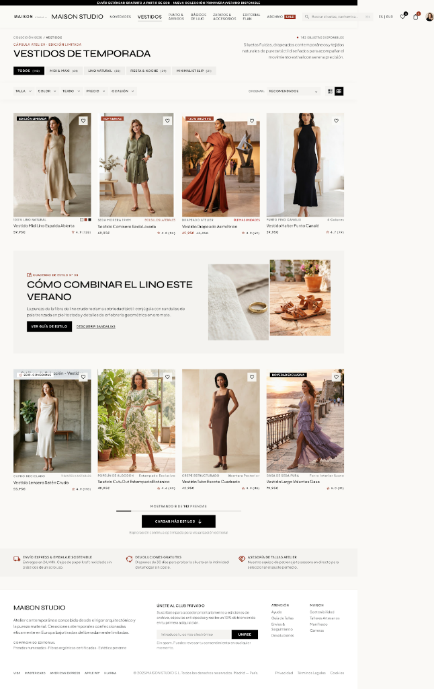

# Wireframes y Diseño UI/UX: FakeStore (Maison Studio)

Documentación del diseño visual, wireframes y arquitectura de interfaz para la aplicación **FakeStore**, basados en el concepto de diseño editorial contemporáneo (*Maison Studio / Editorial Modernism*).

---

## 1. Boceto Principal (Mockup de Alta Fidelidad)

> **Referencia del proyecto en Stitch:**  
> `web application/stitch/projects/11738115086308387021/screens/895953f38b01481cbc1ce6c3026529dd`

---

## 2. Desglose de Componentes del Wireframe

### A. Encabezado y Navegación Superior
* **Barra de utilidades:** Avisos de servicio (ej: envíos y colecciones) y accesos de usuario.
* **Header principal:** 
  * Logotipo de la marca (`FakeStore` / `Maison Studio`).
  * Enlaces de navegación rápida por categorías y colecciones.
  * Botones de acción fija: buscador, acceso al **Historial de compras** y disparador del **Carrito de compras** con contador dinámico de unidades.

### B. Barra de Controles y Filtros
* **Buscador interactivo:** Input de búsqueda en tiempo real sobre títulos y descripciones.
* **Filtros por categoría:** Selectores y píldoras para filtrar dinámicamente los artículos.
* **Ordenamiento:** Desplegable para ordenar por precio (ascendente/descendente) y orden alfabético.

### C. Cuadrícula del Catálogo (Grid de Productos)
* **Distribución responsiva:**
  * **Desktop (> 1100px):** Cuadrícula regular de 4 columnas.
  * **Tablets (561px - 1100px):** Cuadrícula de 2 a 3 columnas.
  * **Móviles (≤ 560px):** Cuadrícula de 1 o 2 columnas compactas.
* **Tarjeta de producto (`.tarjeta-producto`):**
  * Fotografía del producto con efecto de elevación y zoom suave al cursor.
  * Etiqueta de categoría en formato badge.
  * Título y descripción con truncamiento visual a 2 líneas (*line-clamp*).
  * Precio destacado en tipografía editorial.
  * Botón interactivo para **Agregar al carrito** con microinteracción de confirmación visual (`✓ Agregado`).
  * **Disparador interactivo:** Al hacer clic sobre cualquier tarjeta, se despliega el **Carrusel modal**.

### D. Visor Modal de Productos (Carrusel Accesible)
* **Ventana superpuesta (Modal):** Se activa bajo demanda al hacer clic sobre cualquier tarjeta del catálogo.
* **Navegación accesible:**
  * Atributo `tabindex="0"` para captura nativa de flechas del teclado (`ArrowLeft` y `ArrowRight`).
  * Botones laterales interactivos (`◄` y `►`).
  * Contador numérico dinámico de posición (`1 / 20`).
* **Cierre accesible:** Cierre mediante botón `✕`, clic en el fondo oscurecido o pulsando la tecla `Escape`.
* **Acción directa:** Botón para añadir el producto seleccionado directamente al carrito.

### E. Panel Lateral (Carrito, Checkout e Historial)
* **Drawer deslizante (`<aside id="carrito">`):**
  * **Vista 1 (Carrito):** Lista de artículos con controles de cantidad (`+` / `-`), botón para eliminar individualmente y cálculo del total acumulado.
  * **Vista 2 (Checkout):** Formulario de compra rápida solicitando Nombre completo, Email y Dirección de entrega.
  * **Vista 3 (Historial):** Registro inmutable con el historial acumulado de compras realizadas persistidas en `localStorage` (`historial_compras`).

### F. Pie de Página y Propuestas de Valor
* **Propuestas de valor:** Indicadores de envío rápido, política de devoluciones y asesoría.
* **Footer institucional:** Enlaces de atención al cliente, suscripción a boletín informativo y sellos de métodos de pago.

---

## 3. Mapeo entre Wireframe y Código Fuente

| Componente del Wireframe | Archivo HTML / Plantilla | Hoja de Estilos CSS | Módulo JavaScript |
| :--- | :--- | :--- | :--- |
| **Header y Controles** | [`index.html`](../../index.html) (`<header>`, `#controles`) | [`catalogo2.css`](../../css/catalogo2.css) | [`catalogo.js`](../../js/catalogo.js) |
| **Grid de Productos** | [`index.html`](../../index.html) (`<main id="catalogo">`) | [`catalogo2.css`](../../css/catalogo2.css), [`responsive.css`](../../css/responsive.css) | [`catalogo.js`](../../js/catalogo.js), [`api.js`](../../js/api.js) |
| **Carrusel Modal** | [`index.html`](../../index.html) (`#modal-carrusel`) | [`catalogo2.css`](../../css/catalogo2.css) | [`catalogo.js`](../../js/catalogo.js) (`iniciarCarrusel`) |
| **Panel Carrito** | [`index.html`](../../index.html) (`#vista-carrito`) | [`carrito2.css`](../../css/carrito2.css) | [`carrito.js`](../../js/carrito.js) |
| **Formulario Checkout** | [`index.html`](../../index.html) (`#vista-checkout`) | [`carrito2.css`](../../css/carrito2.css) | [`carrito.js`](../../js/carrito.js) |
| **Vista Historial** | [`index.html`](../../index.html) (`#vista-historial`) | [`carrito2.css`](../../css/carrito2.css) | [`carrito.js`](../../js/carrito.js) (`renderizarHistorial`) |

---

## 4. Principios de Diseño Aplicados
1. **Tipografía Editorial:** Uso de fuentes serif/modernist con jerarquías claras para títulos y sans-serif legible para textos descriptivos y botones.
2. **Espaciado y Retícula:** Uso de unidades relativas (`rem`, `clamp`) y `gap` consistente en Grid y Flexbox.
3. **Contraste y Accesibilidad:** Colores que cumplen con la relación de contraste W3C para textos y elementos interactivos con anillos de foco visibles.

